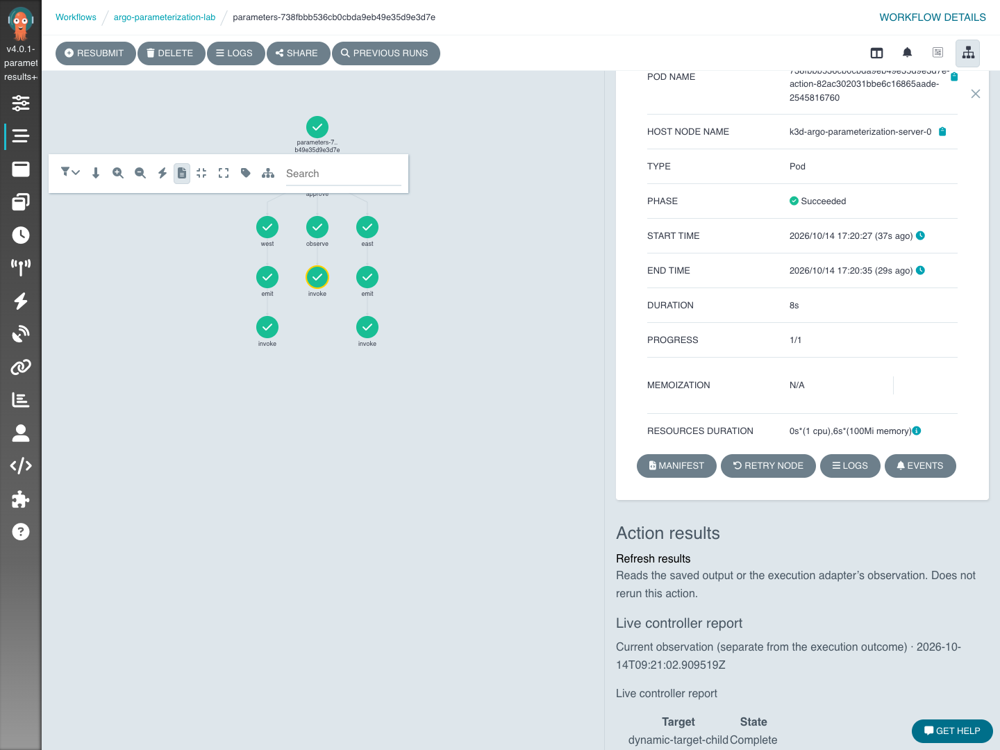

# Bound action results (experimental)

Results are reusable contracts, independently bound at native action call sites.
This extension does not add external SDKs, a query scheduler or a second workflow engine to Argo Server.
An action's native implementation still runs in a Pod, HTTP template, or Kubernetes Resource template.
A separately installed controller may maintain a resource's public status by querying an external service.

## Definitions and identity

ActionResultTemplate is a namespaced definition containing `source`, `schema`, `mappings` and `views`.
It has the same editing, named publication, diff and static status lifecycle as other reusable definitions.
Published specs are immutable.
The experimental API group remains `parameters.workflows.example.io/v1alpha1`.

`WorkflowActionBinding.spec.calls[].resultBindings` selects result templates and maps action outputs to their source slots at a specific `callPath`.
The optional `ActionDefinition.spec.results` field supplies defaults.
Explicit per-call bindings replace those defaults.
Reusing an action does not force its callers to share a view, source slot mapping or result name.
A result template cannot change the action implementation, its inputs or its permissions.

```yaml
apiVersion: parameters.workflows.example.io/v1alpha1
kind: ActionResultTemplate
metadata:
  name: task-report-v1
spec:
  title: Task report
  source:
    parameter: report-json
    format: json
  schema:
    type: object
    required: [state]
    properties:
      state: {type: string}
  mappings:
    - from: /response/status
      to: state
  views:
    - title: Outcome
      type: summary
      columns:
        - title: State
          path: /state
          format: status
---
apiVersion: parameters.workflows.example.io/v1alpha1
kind: WorkflowActionBinding
metadata:
  name: task-calls-v1
spec:
  workflowTemplate: native-pipeline
  calls:
    - callPath: [main, build]
      actionDefinition: run-build-v1
      resultBindings:
        - name: report
          resultTemplate: task-report-v1
          outputMappings:
            - from: actual-report
              to: report-json
```

The selected action must declare the output `actual-report`.
Input parameters, implementation references and output/artifact mappings retain their existing native action-binding semantics.
Result sources may only use the chosen action's outputs; they cannot name another task or select a provider's "latest" run.

Preview resolves references under caller RBAC and records their content versions.
Submission freezes resolved per-call results and source definitions in `WorkflowSubmission.spec.definitions`.
A changed reference invalidates a stale preview.
Checked partial retry freezes the new definitions in ParameterRetry.
A retained successful node follows its original receipt; it is not reinterpreted using the new result schema.
Failed/re-executed nodes use the new binding.
Both original and changed-parameter retries retain the previous Workflow snapshot.
No result read dispatches a retry or creates another Workflow.

## Sources and execution adapters

A parameter source decodes one native output as JSON or text.
It is an execution snapshot, not a live query.
JSON Pointer `mappings` select public fields into a new top-level object before schema validation.
An omitted mapping validates the whole source.
Missing fields and schema mismatches are reported, not silently converted into an empty successful result.

A resource source reads an exact object produced by the invocation:

```yaml
source:
  format: json
  resource:
    group: results.example.io
    version: v1alpha1
    resource: resultqueries
    nameOutput: query-name
    uidOutput: query-uid
    documentPath: /status/document
    observedAtPath: /status/observedAt
    maxAgeSeconds: 30
```

Both identity slots must be native outputs.
Alternatively, a producer can be allocated before an invocation starts: use `nameInput` and `uidInput` with two distinct declared native input parameters.
This allows a Running or Failed invocation to expose maintained progress without waiting for output collection.
Exactly one complete input or output pair is required; mixed pairs are invalid.
The frozen native inputs identify that attempt's object and are not refreshed from the current ParameterSet.
A result binding can use `inputMappings` to map the action's actual input names to a reusable result template's identity slots, just as `outputMappings` maps output identity slots.
Mapping does not create the producer or grant access to it.
Reads require the same namespace, matching UID, a non-terminating object and an owner reference to this Workflow UID.
A replaced object with the same name is rejected.
Supported documents are custom resource `/status/...` and produced ConfigMap `/data/...` fields.
Core Secrets, arbitrary namespaces, Kubernetes authorization objects and native Workflow resources are not result sources.
The current caller must have read permission on the Workflow, frozen receipts and selected resource.
Definitions grant no RBAC.

The adapter owns query method selection, connection credentials, provider paging, protocol decoding and public data projection.
It should validate the actual operation identity before querying.
Business-specific HTTP paths and credentials never belong in Argo's core result handler or the uploaded input form.
A Resource template can create a query CR with mapped inputs; its controller updates status.
Alternatively a Pod can call an adapter and produce a snapshot output/artifact.
The extension does not claim support for every Executor Plugin implementation.

`examples/parameterization/result-observer` is an example-only controller and synthetic provider, with a separate `results.example.io` CRD.
Its operator-owned endpoint and allowed `report.read` operation illustrate this separation.
It is not a production connector.
Adapting an existing controller may require a small public projection resource if its current objects lack the required ownership or stable output identities; no runtime rewrite is implied.

## Read and view contract

`GET /api/v1/parameterization/{namespace}/node-results/{workflow}?uid=...&nodeId=...` returns an invocation fingerprint, frozen contract digest and independent result items.
`history=<ParameterRetry name>` reads that receipt's previous attempt.
External resources are explicitly labeled `LiveObservation`, even when accessed through history.
They never pretend to be a frozen historical health value.
Capture historical observations in output parameters or immutable artifacts when that is required.
A changed health observation never writes native execution state.

Supported view types are summary, table, tree and text.
Fields use JSON Pointers; table/tree rows must be arrays.
Columns can display text, status or an HTTP(S) link without embedded credentials.
Text is escaped; no report script or HTML is executed.
Views are inert data, distinct from editable WorkflowForm definitions.
Artifacts retain Argo's native artifact UI and authenticated download path; they are not fetched, parsed or included by the result endpoint.

The node panel reads on selection and explicit refresh.
Partial failures retain other successful result items.
Transport failure identifies previously loaded content as old; authorization failure clears it.
Switching nodes/attempts drops stale in-flight responses.
Refresh reads maintained status, not necessarily a new external query.
`observedAt` and `stale` expose that distinction.
Controller refresh policy remains with the executor.

Bounds: at most 16 results, `256 KiB` normalized data each, `32 KiB` schemas, 64 field mappings, 16 views and 32 columns per view; the aggregate request has a ten-second timeout.
Tables paginate 50 rows; tree/table display caps at 1,000 rows and eight nested levels with a notice.
Use native artifacts for larger reports.
Historical receipt traversal is limited to 32 hops and fails explicitly if it cannot prove the origin.
Archived/deleted Workflow result panels and remote artifact parsing are outside this increment.
Existing native artifact/history views still apply.



## Testing

Run the normal Go/UI parameterization tests and `test/parameterization/result_bindings_e2e.py` in the [isolated local installation](getting-started.md).
The case covers definition storage and validation, two calls to one action with different views, a native Resource query plus independent controller, read-only refresh, failed execution, changed-parameter retry on the same Workflow, preserved approval and successful node/Pod identities, frozen historical results, and the browser panel.
`action_calls_e2e.py`, `action_reference_e2e.py`, `definition_publications_e2e.py` and `execution_diff_e2e.py` cover the affected binding, original-retry, publication and diff paths.
No production cluster or external business provider is used.
