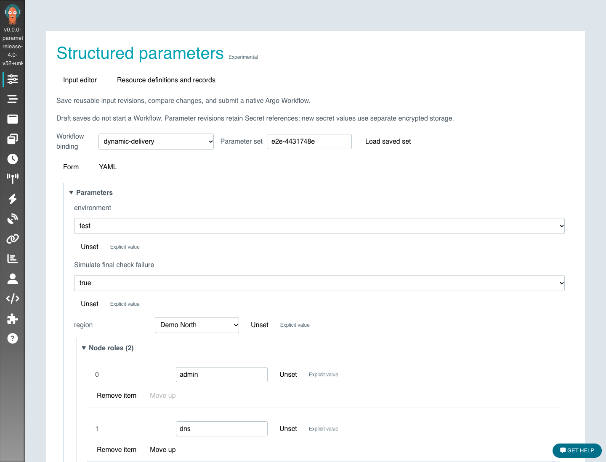

# Structured parameters

Use structured parameters when callers need to edit nested values, share a form for a WorkflowTemplate, compare saved inputs, or retry selected calls with reviewed changes.
The extension validates those values, maps them to native Workflow arguments and records the definitions used by each execution.
The native Argo controller continues to schedule tasks and manage their state.

This feature is experimental and disabled by default.
Its separately installed resources use `parameters.workflows.example.io/v1alpha1`; the community has not approved a stable API group or compatibility contract.
Start in an isolated cluster using the synthetic examples below.
Workflows without parameter bindings retain their native submission and execution paths.

## Install an isolated example

Use a dedicated kubeconfig and context so the example does not replace an existing Argo installation or its cluster-scoped CRDs.
The example uses a separate k3d cluster running k3s, the namespace `argo-parameterization-lab` and controller instance ID `parameterization-lab`.
The bundled manifests use local images and server authentication for loopback access only.
Shared installations must configure client or SSO authentication and caller-scoped Kubernetes RBAC.

```sh
k3d cluster create argo-parameterization --image rancher/k3s:v1.32.8-k3s1 \
  --api-port 127.0.0.1:6551 --kubeconfig-update-default=false \
  --kubeconfig-switch-context=false \
  --k3s-arg '--disable=traefik,servicelb,metrics-server@server:0' \
  --k3s-arg '--secrets-encryption@server:0' \
  --k3s-arg '--secrets-encryption-provider=secretbox@server:0'
k3d kubeconfig get argo-parameterization > ./parameterization.kubeconfig
chmod 600 ./parameterization.kubeconfig
export KUBECONFIG="$PWD/parameterization.kubeconfig"
```

Build the UI, `dist/argo` with the `ui` build tag, and `dist/workflow-controller` for the architecture of the local cluster using this checkout's supported Go toolchain.
Build the image with `manifests/parameterization/Dockerfile.local`, then import it with `k3d image import IMAGE -c argo-parameterization`.
Set the image in `manifests/parameterization/local-install.yaml` to the imported tag.
The Deployment uses `imagePullPolicy: Never`.
Build the UI before the embedded server binary, and build the image after both binaries complete.

Install the native and experimental CRDs, immutable-snapshot protection and local namespace resources:

```sh
kubectl --context k3d-argo-parameterization apply --server-side -k manifests/base/crds/full
kubectl --context k3d-argo-parameterization apply -f manifests/parameterization/immutable-snapshots.yaml
kubectl --context k3d-argo-parameterization apply -f manifests/parameterization/crds.yaml
kubectl --context k3d-argo-parameterization wait crd --all --for=condition=Established --timeout=60s
kubectl --context k3d-argo-parameterization apply -f manifests/parameterization/local-install.yaml
kubectl --context k3d-argo-parameterization apply -f examples/parameterization/demo.yaml
kubectl --context k3d-argo-parameterization -n argo-parameterization-lab \
  port-forward svc/argo-server 2747:2746
```

The Server requires `ARGO_PARAMETERIZATION_ENABLED=true`.
Use the enhanced Server and controller from the same checkout.
For clusters without ValidatingAdmissionPolicy, the separately installed namespace-scoped validating webhook also enforces immutable snapshots.
See `manifests/parameterization` for the optional admission and definition-status controller manifests.
Install admission protection before allowing users to submit parameterized Workflows.

## Fill, save and execute

Open `http://127.0.0.1:2747/parameters/argo-parameterization-lab`.
A native WorkflowTemplate's details and Submit panel also list compatible parameter bindings.
Opening a binding only reads definitions.

1. Select the `dynamic-delivery` binding and enter a new parameter set name.
2. Switch to YAML and paste `examples/parameterization/topology-values.yaml`.
3. Switch back to Form and expand the zones, subnets and roles.
   Add or remove items; the form and YAML editor share one parameter document.
4. Save, change a value and save again.
   Compare the saved revisions, or restore an earlier revision into the editor and save it as a new revision.
5. Validate and preview the compiled native Workflow, then explicitly submit it.
6. Open the Workflow and resume its approval suspend node.
   The synthetic example creates namespace-local ConfigMaps for the chosen combinations.
7. Open the execution's parameter snapshot to inspect the exact saved values and definitions it used.



The `training` binding demonstrates another model using a native container action.
The `intermediate-demo` binding accepts an empty initial parameter set and presents a form at a native suspend node.
Its downstream task consumes the accepted form outputs.
See [contracts](contracts.md) for resource references, defaulting and concurrency behavior.

## Publish reusable definitions

Open **Structured parameters → Resource definitions and records** to inspect or author parameter templates, forms, parameter bindings, actions, action bindings and result templates.
Definition validation performs server-side dry-run under your Kubernetes identity.
Execution preview separately checks the concrete input values and resolved references.

Choose **Publish named version** to create an immutable definition under a distinct name.
The source definition remains available for editing.
**View published versions** supports history and comparison; **Clone as new definition** creates an editable copy.
Select the published or cloned name in a binding before saving and submitting parameters.
A named version covers one definition; submission separately freezes the full referenced definition closure.

The optional definition-status controller reports validation and observed reference identities.
A status whose `observedGeneration` is stale indicates pending validation.
The controller does not dispatch Workflows or read Secret values.

## Retry in the same Workflow

To demonstrate an external dependency failure, set `fail: true` and submit a new revision.
The resource tasks succeed and the final check fails.
Create a ConfigMap named `<workflow-name>-recovery` with `data.allow: "true"` in the example namespace, then retry with the original parameters.
The Workflow UID and retained successful results remain unchanged.

For changed-parameter retry, save a new revision from the execution view, choose **Preview partial retry**, inspect affected calls and retained results, then explicitly apply it.
A new submission remains a separate action that creates a new Workflow.
Saving a draft or viewing a diff does not retry or submit anything.

Authors must declare `parameters.workflows.example.io/retry-safe: idempotent` for affected executable leaves and `parameters.workflows.example.io/result-reuse: same-inputs` for reusable results.
These declarations describe adapter behavior; they cannot make an arbitrary external operation idempotent.
The server checks retained execution fingerprints against native retry before changing the Workflow.
Concurrent execution changes invalidate the preview.

The supported shapes include declared DAG and Steps calls, statically named nested calls and native leaf retry groups.
An author can opt named loops into whole-expansion replacement with `parameters.workflows.example.io/retry-loop-calls`.
Changed loop identities do not reuse positional results.
Arbitrary topology replacement, memoized results, composite retry groups and unsupported artifact storage fail before mutation.
See [retry contracts](contracts.md#checked-new-parameter-native-retry) for the remaining constraints.

## Files and result views

`examples/parameterization/artifact-mappings.yaml` demonstrates native action input/output artifact mapping.
`artifact-retry.yaml` demonstrates checked reuse of a retained HTTP artifact after a changed-parameter retry.
For that example, save `{"mode":"bad"}`, execute and resume the approval, then save `{"mode":"good"}` and preview a partial retry.
The consumer reruns while the producer Pod UID and approval remain unchanged.
Other artifact storage types are outside the checked changed-parameter reuse subset.

Use [bound action results](execution-results.md) to render each call's outputs or an execution adapter's maintained status.
Refreshing a result reads status; it does not submit a task or initiate another external operation.
The example observer uses synthetic data and is not a production connector.

## Sensitive values

The encrypted-input example requires Kubernetes encryption at rest and metadata-only auditing of Secret writes.
Configure `ARGO_PARAMETERIZATION_SECRET_BACKEND=kubernetes-encrypted` only when those prerequisites hold.
`ARGO_PARAMETERIZATION_ALLOW_LOOPBACK_SECRET_INPUT=true` permits HTTP input only in the isolated loopback lab and only when that backend is enabled.
Shared deployments require HTTPS.

Select `secret-demo`, store a synthetic value of at least 16 characters, then save and submit its reference.
The native container consumes a Secret reference and emits a consumption marker without printing the value.
`secret-array-demo` and `secret-input-demo` cover arrays and intermediate forms.
Saved revisions and ordinary Workflow arguments do not contain plaintext credentials.

An optional Vault KV-v2 controller materializes exact external versions as immutable Kubernetes Secrets.
An administrator controls its origin, paths, namespace and token file.
Original retries retain their pinned version; a reviewed new submission or parameter retry can resolve a newer version.
See [external Secret contracts](contracts.md#registered-external-secret-backend) for expiry and dispatch-time limits.

## Dynamic credentials

`examples/parameterization/dynamic-credentials.yaml` binds a native Vault Agent action that acquires a new database credential for each task attempt.
The example records an opaque lease identifier and renews the lease while the task runs.
Completion or cancellation stops renewal; the remaining lease expires according to its TTL.
It does not promise immediate revocation or credential replacement inside an existing process.

Build `examples/parameterization/dynamic-credentials/Dockerfile` with the tag expected by its fixture and import it into the isolated cluster.
Run `test/parameterization/dynamic_leases_e2e.py --install-demo` to install the synthetic Vault/PostgreSQL backend and a 24-hour bootstrap reference without submitting a Workflow.
Select `dynamic-credential-demo` and save:

```json
{"credential":{"secretRef":{"name":"dynamic-credential-demo","key":"token"}}}
```

Preview, submit and resume the approval.
The task performs read-only database queries for approximately 36 seconds.
Reinstall the fixture explicitly after its bootstrap token expires.
Never install the development Vault fixture into a shared environment.

## Verification

See [testing](testing.md) for bounded full-path suites and regression groups.
See [the Chinese walkthrough](getting-started.zh.md) for the same user flow in Chinese.
