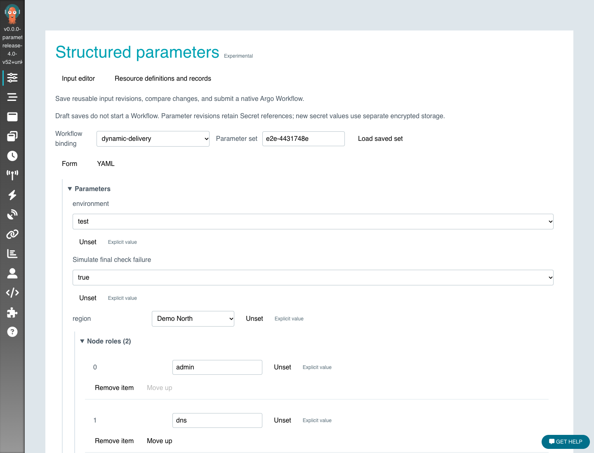

# Structured parameters

Use structured parameters when callers need to edit nested values, share a form for a WorkflowTemplate, compare saved inputs, or retry selected calls with reviewed changes.
The extension validates those values, maps them to native Workflow arguments and records the definitions used by each execution.
The native Argo controller continues to schedule tasks and manage their state.

This feature is experimental and disabled by default.
Its separately installed resources use `parameters.workflows.example.io/v1alpha1`; the community has not approved a stable API group or compatibility contract.
Evaluate the feature in an isolated installation before granting access to other users.
Workflows without parameter bindings retain their native submission and execution paths.

## Enable structured parameters

Install matching Argo Server and workflow-controller release images that include this experimental feature, following the [installation guide](../installation.md).
Use the parameterization manifests shipped with the same release.
Select the intended Kubernetes context and namespace before applying them.
The commands below run from the unpacked release source directory and assume Argo Server uses the Deployment name `argo-server`.

```sh
export ARGO_NAMESPACE=argo
kubectl apply -f manifests/parameterization/crds.yaml
kubectl apply -f manifests/parameterization/immutable-snapshots.yaml
kubectl -n "$ARGO_NAMESPACE" set env deployment/argo-server ARGO_PARAMETERIZATION_ENABLED=true
kubectl -n "$ARGO_NAMESPACE" rollout status deployment/argo-server
```

Install immutable-snapshot protection before accepting parameterized submissions.
On clusters without ValidatingAdmissionPolicy, install the namespace-scoped `parameterization-admission` webhook instead.
Its image uses `manifests/parameterization/Dockerfile.admission`; configure a serving certificate trusted by the Kubernetes API server and read access to the referenced definitions.
The webhook checks the caller's permissions through SubjectAccessReview and requires `create` on `subjectaccessreviews.authorization.k8s.io`.
It excludes unrelated native Workflows.

The optional definition-status controller uses `manifests/parameterization/Dockerfile.controller` and `manifests/parameterization/definition-status-controller.yaml`.
It reports validation status and does not schedule Workflows.
Build these auxiliary controller images separately when your release distribution does not provide them.
Local image builds, k3d setup and synthetic Vault fixtures are documented in the [developer test guide](https://github.com/argoproj/argo-workflows/tree/release-4.0/test/parameterization).

### Caller permissions

Use client or SSO authentication for a shared installation.
The Server uses the caller's Kubernetes identity; enabling the feature grants no additional RBAC.
Grant only the operations the caller needs in the target namespace:

| Operation | Resources and verbs |
| --- | --- |
| Discover and read definitions | `get`, `list` on ParameterTemplate, WorkflowForm, WorkflowParameterBinding, WorkflowActionBinding, ActionDefinition and ActionResultTemplate. |
| Author or publish definitions | `create`, `update`, `patch` on the specific editable definition kinds, plus their read permissions. Published specs remain immutable. |
| Save parameters and read history | `get`, `list`, `create`, `update` on ParameterSet; `get`, `list`, `create` on ParameterRevision. |
| Submit and inspect execution | `get`, `list`, `create` on WorkflowSubmission; native Workflow permissions for `create`, `get`, `list`, `watch`, `update` and `patch`. |
| Retry or complete intermediate input | `get`, `list`, `create` on ParameterRetry and ParameterNodeInput, plus native Workflow read and update permissions. |
| Resolve native templates | `get` on referenced WorkflowTemplate objects; separately grant cluster-scoped `get` on ClusterWorkflowTemplate only when a binding uses it. |
| Use sensitive references | `get` on the referenced Secrets and reference-index ConfigMaps; encrypted form input also requires `create` on Secrets. |

Definition resources and receipts use `parameters.workflows.example.io`; native Workflow resources use `argoproj.io`.
Execution adapters need their own permissions for the resources they operate on.
See [authentication modes](../argo-server-auth-mode.md) for bearer identity validation and older Kubernetes versions.

## Fill, save and execute

Open **Structured parameters** in your Argo Server and select the namespace containing your definitions.
The steps below use the synthetic definitions in `examples/parameterization/demo.yaml`; its local setup is in the developer test guide.
A native WorkflowTemplate's details and Submit panel also list compatible parameter bindings.
Opening a binding only reads definitions.

1. Select the `dynamic-delivery` binding and enter a new parameter set name.
2. Switch to YAML and paste `examples/parameterization/topology-values.yaml`.
3. Switch back to Form and expand the zones, subnets and roles.
   Add or remove items; the form and YAML editor share one parameter document.
4. Save, change a value and save again.
   Compare the saved revisions, or restore an earlier revision into the editor and save it as a new revision.
5. Validate and preview the compiled native Workflow, then explicitly submit it.
6. Open the Workflow and resume its approval suspend node.
   The synthetic example creates namespace-local ConfigMaps for the chosen combinations.
7. Open the execution's parameter snapshot to inspect the exact saved values and definitions it used.



The `training` binding demonstrates another model using a native container action.
The `intermediate-demo` binding accepts an empty initial parameter set and presents a form at a native suspend node.
Its downstream task consumes the accepted form outputs.
See [contracts](contracts.md) for resource references, defaulting and concurrency behavior.

## Publish reusable definitions

Open **Structured parameters → Resource definitions and records** to inspect or author parameter templates, forms, parameter bindings, actions, action bindings and result templates.
Definition validation performs server-side dry-run under your Kubernetes identity.
Execution preview separately checks the concrete input values and resolved references.

Choose **Publish named version** to create an immutable definition under a distinct name.
The source definition remains available for editing.
**View published versions** supports history and comparison; **Clone as new definition** creates an editable copy.
Select the published or cloned name in a binding before saving and submitting parameters.
A named version covers one definition; submission separately freezes the full referenced definition closure.

The optional definition-status controller reports validation and observed reference identities.
A status whose `observedGeneration` is stale indicates pending validation.
The controller does not dispatch Workflows or read Secret values.

## Retry in the same Workflow

To demonstrate an external dependency failure, set `fail: true` and submit a new revision.
The resource tasks succeed and the final check fails.
Create a ConfigMap named `<workflow-name>-recovery` with `data.allow: "true"` in the example namespace, then retry with the original parameters.
The Workflow UID and retained successful results remain unchanged.

For changed-parameter retry, save a new revision from the execution view, choose **Preview partial retry**, inspect affected calls and retained results, then explicitly apply it.
A new submission remains a separate action that creates a new Workflow.
Saving a draft or viewing a diff does not retry or submit anything.

Authors must declare `parameters.workflows.example.io/retry-safe: idempotent` for affected executable leaves and `parameters.workflows.example.io/result-reuse: same-inputs` for reusable results.
These declarations describe adapter behavior; they cannot make an arbitrary external operation idempotent.
The server checks retained execution fingerprints against native retry before changing the Workflow.
Concurrent execution changes invalidate the preview.

The supported shapes include declared DAG and Steps calls, statically named nested calls and native leaf retry groups.
An author can opt named loops into whole-expansion replacement with `parameters.workflows.example.io/retry-loop-calls`.
Changed loop identities do not reuse positional results.
Arbitrary topology replacement, memoized results, composite retry groups and unsupported artifact storage fail before mutation.
See [retry contracts](contracts.md#checked-new-parameter-native-retry) for the remaining constraints.

## Files and result views

`examples/parameterization/artifact-mappings.yaml` demonstrates native action input/output artifact mapping.
`artifact-retry.yaml` demonstrates checked reuse of a retained HTTP artifact after a changed-parameter retry.
For that example, save `{"mode":"bad"}`, execute and resume the approval, then save `{"mode":"good"}` and preview a partial retry.
The consumer reruns while the producer Pod UID and approval remain unchanged.
Other artifact storage types are outside the checked changed-parameter reuse subset.

Use [bound action results](execution-results.md) to render each call's outputs or an execution adapter's maintained status.
Refreshing a result reads status; it does not submit a task or initiate another external operation.
The example observer uses synthetic data and is not a production connector.

## Sensitive values

The encrypted-input example requires Kubernetes encryption at rest and metadata-only auditing of Secret writes.
Configure `ARGO_PARAMETERIZATION_SECRET_BACKEND=kubernetes-encrypted` only when those prerequisites hold.
`ARGO_PARAMETERIZATION_ALLOW_LOOPBACK_SECRET_INPUT=true` permits HTTP input only in the isolated loopback lab and only when that backend is enabled.
Shared deployments require HTTPS.

Select `secret-demo`, store a synthetic value of at least 16 characters, then save and submit its reference.
The native container consumes a Secret reference and emits a consumption marker without printing the value.
`secret-array-demo` and `secret-input-demo` cover arrays and intermediate forms.
Saved revisions and ordinary Workflow arguments do not contain plaintext credentials.

An optional Vault KV-v2 controller materializes exact external versions as immutable Kubernetes Secrets.
An administrator controls its origin, paths, namespace and token file.
Original retries retain their pinned version; a reviewed new submission or parameter retry can resolve a newer version.
See [external Secret contracts](contracts.md#registered-external-secret-backend) for expiry and dispatch-time limits.

## Dynamic credentials

`examples/parameterization/dynamic-credentials.yaml` binds a native Vault Agent action that acquires a new database credential for each task attempt.
The example records an opaque lease identifier and renews the lease while the task runs.
Completion or cancellation stops renewal; the remaining lease expires according to its TTL.
It does not promise immediate revocation or credential replacement inside an existing process.

The native action requires an administrator-provisioned Vault service, database role and bootstrap Secret reference.
Build the action image from `examples/parameterization/dynamic-credentials/Dockerfile` and configure the registered endpoint before binding it to a Workflow.
Use a reference to the bootstrap Secret as the `credential` input.
The local synthetic Vault/PostgreSQL fixture and its test installation commands belong to the [developer test guide](https://github.com/argoproj/argo-workflows/tree/release-4.0/test/parameterization).
